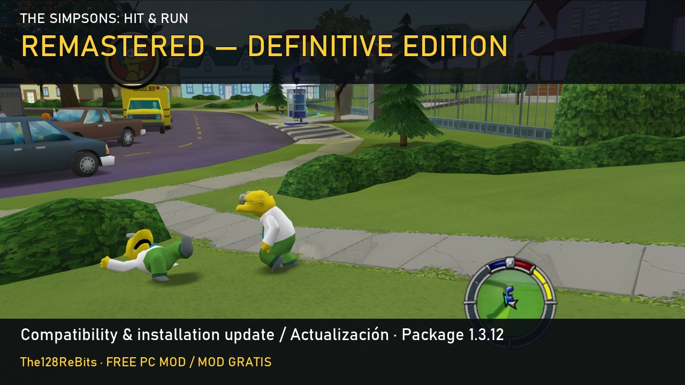

# The Simpsons Hit & Run Remastered — Definitive Edition

**A clearer Springfield, with the original game's drawing, colours and personality in mind. Free PC mod by The128ReBits.**

I compared around 3,700 textures one by one, choosing between improved versions while keeping the original artwork as my reference. This is the existing remaster, now distributed as **complete package 1.3.12** with local SHARLatino compatibility and installation fixes. Its texture and graphics foundation is retained; this update does not claim thousands of newly remade textures.

**[Download the complete package 1.3.12 on ModDB](https://www.moddb.com/mods/the-simpsons-hit-run-definitive-edition-by-the128rebits/downloads/definitive-edition-complete-update-package-1312)** · [Earlier remaster gameplay with DLSS Feeder](https://www.youtube.com/watch?v=_9em6iei33o) · [Earlier gameplay with Faithful ReShade](https://www.youtube.com/watch?v=9gB4pSp6yOY)

## The remaster's existing foundation

- Around 3,700 individually compared/selected textures covering scenery, characters, cars, interface, objects and effects. The review involved 3,708 decisions and 3,704 subsequently checked images, not 3,708 new textures in this update.
- Mod Settings: groups, files by level and Complete / World-characters-cars / Interface only / All original / Custom presets.
- Modern mode: mipmaps, anisotropic filtering up to 16x, trilinear filtering and LOD adjustments to reduce shimmering on angled roads/surfaces.
- Faithful ReShade: gentle HAR_Color finish, Deband against sky banding and six presets.
- Optional DLSS 5 Feeder for NVIDIA RTX, particularly the 50 series, personally tried on an RTX 5070 Ti.

DLSS 5 Feeder is an **external neural graphics pass**, not native game DLSS or frame generation. It can alter light, colour and detail and use substantial GPU resources. No FPS improvement or identical results across PCs are promised. Faithful ReShade and DLSS are alternatives.

## Why package 1.3.12

This update focuses on local **SHARLatino 0.8 by Jebano compatibility and installation fixes**. It prepares the three shared environments (levels 1, 4 and 7) and four loading screens on the player's computer, preserving the remaster textures alongside the Latino changes. Jebano's mod must be installed separately; neither his mod nor his recordings are included or downloaded.

The accumulated fixes address the crash after “All rights reserved” involving ReShade/antialiasing on AMD, Meta.ini warnings from internal option-bridge folders, and handling of failed optional DLSS downloads. If that download fails, the rest can install with DLSS disabled and a notice. There are clearer permissions/Windows-folder messages and package-specific guides. In 1.3.12 the installer engine is visible in Motor, with official Python and readable code.

## Installation and download

You need your **own complete PC game and Lucas' Mod Launcher**. No game is supplied. The 1.3.12 download is complete; the lower 1.3.6 package is not required.

1. Download the complete RAR from ModDB. This repository contains presentation, installation and reporting documentation. GitHub's automatic **Source code** archives are not the playable mod.
2. Extract the entire RAR outside the game folder. Keep `Instalar_Compatibilidad_Latino.exe`, `Motor`, `Contenido` and `PAQUETE.json` together. Close the game and Lucas.
3. Run the installer, select the folder containing Simpsons.exe and the installed game dub. Choose the installer interface language separately.
4. For Latino, install SHARLatino 0.8 separately first, then prepare the local adaptation. Parts SHARLatino retains in Spain Spanish remain so.
5. Choose the desired modules. Use Faithful ReShade **or** DLSS Feeder. Missing Lucas is offered from its [official source](https://launcher.donutteam.com/); optional graphics components come from their original sources.
6. Open Lucas from the prepared shortcut/profile and follow the included guide. With Latino, enable SHARLatino too. Graphics modules use Direct3D 9; Aspect Ratio Support enables widescreen.

The installer and documentation have seven languages: ES, EN, PT-BR, FR, DE, IT and PL. File checks, backups and undo/uninstall options are included. Keep the backups.

The original RAR is about 2.43 GB, above GitHub's 2 GiB per-asset limit, so this page links directly to its full download on ModDB. It has not been split or rebuilt for GitHub.

## Languages and reports

I've played in Spain Spanish, English and Latin American Spanish via SHARLatino. French/German resources are prepared and files checked, but I haven't managed to start my installations with menus in those languages and haven't tested their voices. Those gameplay tests remain incomplete. Reports from French/German players would be very welcome!

Use **Issues** and include language, package/component version, level or mission, character/car, graphics options/GPU when relevant, other mods and reproduction steps. Automatic file checks are not additional gameplay tests.

**1.3.12 is the distribution package number**, not every internal component's version: PAQUETE.json is 1.2.3, installer engine 3.1.0, graphics modules 1.2.1.

## Also available: a separate character-and-car mod

[All Playable Characters & All Playable Cars](https://www.moddb.com/mods/all-playable-characters-all-playable-cars) offers 110 selectable models including variants, 88 free cars and all seven levels, with optional scaling and original voice repertoires. It is a **separate download and works without this remaster or its update**. To combine them, install the remaster first, then the character mod using its own installer.

## Español

Soy The128ReBits. Mi remaster busca mejorar la definición conservando el dibujo, los colores y la personalidad del original. Su base son unas 3.700 texturas comparadas y elegidas una a una, opciones por grupos/niveles, Modo moderno, ReShade Fiel y DLSS 5 Feeder opcional.

El **paquete completo 1.3.12 actualiza el proyecto existente con compatibilidad local con SHARLatino y correcciones de instalación**. Las texturas y la base gráfica se mantienen. Para latino instala primero SHARLatino 0.8 de Jebano por separado; no incluyo ni descargo su mod ni sus grabaciones. Extrae todo el RAR y abre `Instalar_Compatibilidad_Latino.exe`, con Motor y Contenido a su lado. Necesitas tu juego de PC y Lucas.

DLSS Feeder es un pase neuronal externo para RTX, probado por mí en una 5070 Ti: puede cambiar la imagen y consumir bastante GPU, sin promesa de más FPS. No es DLSS nativo ni generación de fotogramas. Se usa como alternativa a ReShade Fiel.

He jugado en castellano, inglés y latino. Francés y alemán están preparados, pero no he logrado que mis instalaciones arranquen con menús en esos idiomas y no he probado sus voces. Sus pruebas jugando siguen incompletas. Si detectas un error, indica idioma, versión, nivel/misión, personaje/coche, otros mods y cómo reproducirlo. ¡Gracias!

El mod de personajes y coches se descarga aparte y funciona sin el remaster ni esta actualización. Si quieres los dos, instala primero este y luego el otro con su instalador.

## How I selected the textures

I used ComfyUI with several image models to produce candidates for each texture. I compared the candidates one by one against the original and chose the version I considered most faithful, rather than automatically choosing the sharpest result. AI assistance was part of producing the candidates; the comparison and final choices were my work. Exact image-model names still need to be consolidated for platform-specific disclosure.

## Manual edition prepared for Donut Team review

There is also a separate textures-only LMLM edition with the configurable texture groups/levels. It excludes the installer, Modern mode's proxy DLL, ReShade and DLSS Feeder. It must be shown with previews recorded without those removed components. A separate readable offline Python source tool can prepare the local SHARLatino adaptation from the player's own installed files; no Jebano recordings are bundled. This is not the complete graphics package or an approved Mod Bakery release. File/preparation checks are not new gameplay tests. See its dedicated download and English/Spanish manual when available.

## Credits and support

Project and improvements: **The128ReBits**. Lucas Mod Launcher/tools: Lucas Cardellini and Donut Team. SHARLatino: Jebano. ReShade: crosire; shaders: crosire, CeeJay.dk and contributors; Deband: haasn; dgVoodoo: Dege; DLSS5-Feeder: jlrouzies-fr and NIGos. Other component authors/licences are listed in the download. Original game: Radical Entertainment / Vivendi Universal Games and Fox. Unofficial fan project. AI-assisted texture improvement with manual comparison/selection; AI assistance in promotional text/media. No new licence over third-party assets is granted by this documentation.

The mod is free. Follow development, share it with a friend, or support future improvements if you want:

[YouTube](https://www.youtube.com/@The128ReBits) · [Instagram](https://www.instagram.com/The128ReBits/) · [TikTok](https://www.tiktok.com/@the128rebits) · [Patreon](https://www.patreon.com/cw/The128ReBits) · [Ko-fi](https://ko-fi.com/the128rebits) · [All links](https://linktr.ee/the128rebits)

